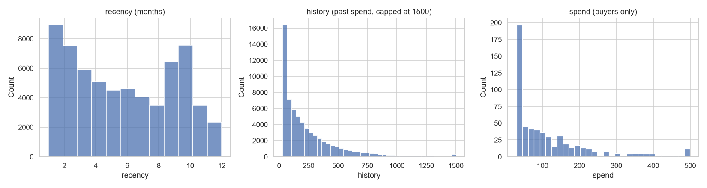
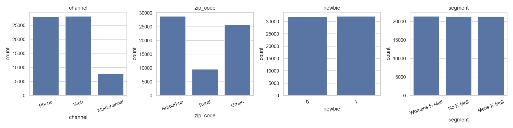
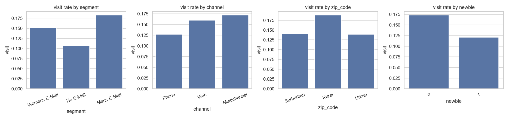
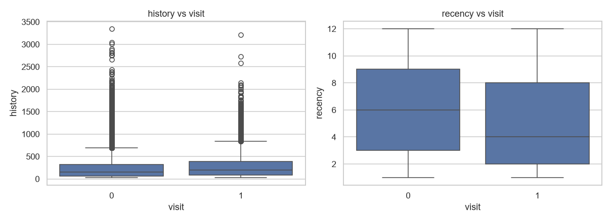
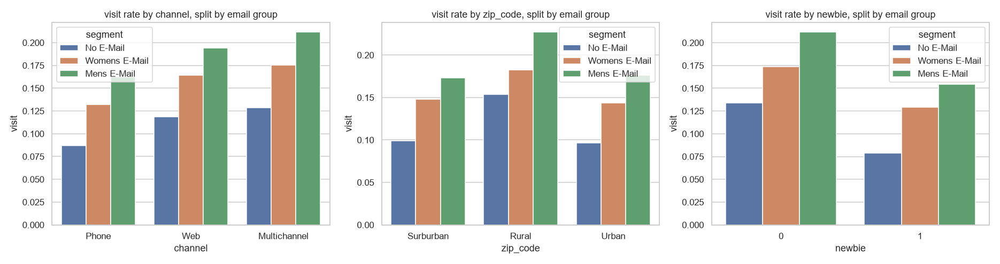
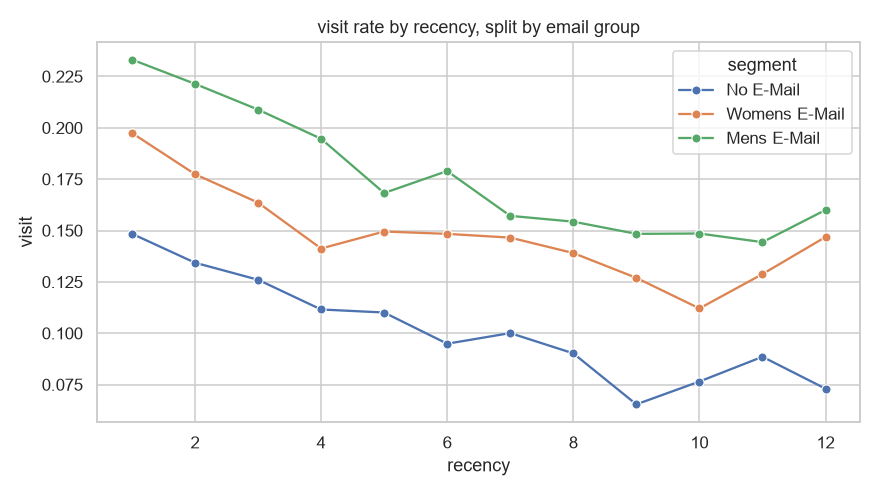
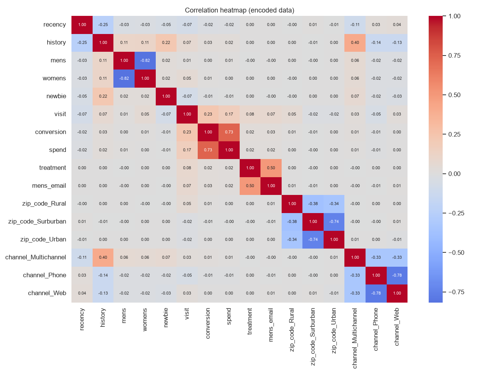

# EconoCausal: EDA on the Hillstrom Email Dataset

64,000 customers were randomly split into three groups: Mens E-Mail, Womens E-Mail and No E-Mail (about 21,300 each).

## Key results
| Group | visit | conversion | spend |
|---|---|---|---|
| No E-Mail | 10.6% | 0.57% | $0.65 |
| Womens E-Mail | 15.1% | 0.88% | $1.08 |
| Mens E-Mail | 18.3% | 1.25% | $1.42 |

## 01 Histograms
recency: most customers bought recently. history and spend are right-skewed (most spend little, a few spend a lot).

## 02 Countplots
The three email groups are the same size, so the groups are balanced.

## 03 Visit rate by group
Both emails raised visits. The Men's email gave the biggest lift. Multichannel, rural and existing customers visit most.

## 04 Boxplots
Visitors bought more recently (median recency 4 vs 6 months) and have slightly higher past spend. History has many high outliers, which is normal.

## 05 Visit rate by group and email
Within every channel, zip code and new/existing group, the order is Men's email, then Women's email, then No E-Mail.

## 06 Visit rate by recency
Visit rate falls as recency rises in all groups. The email gap is biggest for recent customers.

## 07 Correlation heatmap
All correlations with visit are small. conversion and spend are outcomes, so they must not be used as model inputs.

## Takeaways
1. The email was assigned randomly, so this data suits causal analysis.
2. The Men's email beats the Women's email, and both beat no email, for every customer type.
3. Next step: a DML model to estimate the causal effect.